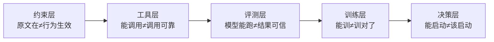

# 终端 Coding Agent：长任务约束遵循与后训练可靠性验证

Agent 约束遵守实验平台——违反归因、可复现评测与训练侧能力边界验证。

针对长任务中压缩静默丢失约束、且“约束在上下文≠模型遵守”的痛点，独立构建终端 Coding Agent 实验平台，把约束失败拆成执行层与意图层逐层归因。

系统侧独立注入把执行层（是否实际调用违规工具）违规从 **22/60 压到 0/60**；训练侧 tagged SFT + 配对监督把意图层（是否明确拒绝/确认）表态缺口归零，**held-out 换表述引用 5/15→12/15**。验证规模：409 任务池、45 任务配对评测、**1003 条测试（1002 passed / 1 skipped）**。方法链：聚合指标 → 拆行为模式 → 控制变量 → 定位根因。

技术栈：Python 3.11 / asyncio / Pydantic / vLLM / QLoRA（peft + trl）/ pytest。`pip install -e ".[dev]"` 后即可用本地 Qwen2.5-7B 或任意工具调用 API 跑起来。

## 核心发现

- **约束层：原文在 ≠ 行为生效**。摘要+补录方案保留 100% 但执行违规 22/60；改为约束独立存储 + 每轮独立注入后，执行层违规 **22/60→0/60**，上下文 615 token、补录 0；但 M2 base 意图层缺口仍 47/60——系统侧管执行、管不住表态。证据见 `docs/experiments/system_side_mechanism_final.md`。

- **工具层：能调用 ≠ 调用可靠**。Tool-Calling Agent Loop + 6 工具（Pydantic 参数校验 + 路径越界拦截），edit_file 三道防线（read-before-edit / mtime 防护 / old_string 唯一性）；幂等键 + checkpoint 恢复。benchmark 48 次运行 466 次工具调用参数 JSON 全合法、路径越界 0 次。代码见 `src/agent/`，测试见 `tests/`。

- **评测层：模型能跑 ≠ 结果可信**。同一任务跑 10 次有 **3.57% 判定翻转**（560 配对），单次不可信；45 任务上 SFT 单次通过率 **49.4%→99.8%**、**pass^10 44/45**。证据见 `docs/evidence/`。

- **训练层：能训 ≠ 训对了**。Loss Masking 单变量对照（full-loss 0/10 → assistant-only 10/10）确认算法是必要条件。**v7 tagged SFT** 行为可迁移（同源 tagged 60/60、held-out 执行层 0/15），但正确引用约束 ID 仅 **5/15**——绑定是模板记忆。**v8 配对监督**（473 条 = 401 + 72 配对，18 约束 × 4 表述）：held-out 正确 ID **5/15→12/15**、同源 tagged **33/60→60/60**、untagged 32/32 未退化（训练时；部署口径见边界）；执行层 0/15 与 0/60。原始 adapter 的残余 2/60 是绑定错误非执行违规。**边界**：诊断集内、n=15、单次 greedy、401→473 数据量同时变、v8 回复仍是 3–4 类模板骨架。证据见 `docs/experiments/paired_supervision_results.md`、`docs/experiments/tagged_training_results.md`。

- **决策层：能启动 ≠ 该启动**。GRPO 预检 360 条 rollout（45 任务 × 8 次）：44/45 已全对、中间态信号为 0——按预注册判据不启动全量 RL。证据见 `docs/evidence/GRPO正确预检.md`。



五层各自独立验证，不跳层外推。

## 为什么做

约束会丢，模型未必遵守；须逐层归因。

## 核心特性

- 运行时：Agent Loop、6 工具、幂等键、checkpoint/流式输出。
- 上下文：四层压缩、约束独立存储、每轮独立注入、补录可控。
- 评测：约束保留、行为 benchmark、trace 归因、稳定性。

**从零实现**：Agent Loop、6 工具、约束独立存储、评测 harness；
**依赖**：vLLM / transformers（本地推理）、peft + trl（QLoRA 训练）、Pydantic（参数校验）。

## 快速开始

Python 3.11+，需支持工具调用的 LLM（本地 Qwen2.5-7B 或 API）；训练侧需 GPU ≥16GB。

```bash
git clone https://github.com/autumnieave/lite-coding-agent.git lite-coding-agent
cd lite-coding-agent && python -m venv .venv && source .venv/bin/activate
pip install -e ".[dev]"

export LLM_API_KEY="..." LLM_BASE_URL="..." LLM_MODEL="..."

lite-agent chat "列出当前目录"
lite-agent chat "列出当前目录" --verbose
```

配置：环境变量 > .env；退出码 0/1/2 = 成功/失败/配置错误。完整参数见 `lite-agent --help`。

**3 分钟检查清单**：
1. `lite-agent chat "列出当前目录"` — 验证 Agent Loop 能跑
2. `pytest -q` — 1003 条测试（1002 passed / 1 skipped，约 1 分钟）
3. 打开 `docs/evidence/会话约束分层验证.md` — 看一条 trace 归因

## 项目结构

```text
lite-coding-agent/
├── src/agent/
│   ├── core/
│   ├── tools/
│   ├── memory/
│   └── cli/
├── scripts/
├── training/
├── tests/
├── docs/evidence/
├── AGENTS.md
├── pyproject.toml
├── LICENSE
└── README.md
```

架构见 `docs/architecture.md`。

## 评测

**约束保留（40 条/25 轮×20 次）**

| 组 | 逐字保留 | 上下文仍在 | 违反 |
|---|---:|---:|---:|
| off | 552/800（69.0%） | 640/800 | 19 |
| on | 760/800（95.0%） | 800/800 | 5 |

**clean held-out（45 任务，7B）**

| 指标 | baseline | SFT |
|---|---:|---:|
| pass@1（单次通过率） | 49.4% | 99.8%（+50.3pp，McNemar p<1e-13） |
| pass^10（10 次全过） | 0/45（外推） | 44/45 |

> baseline 仅 8 次观测：pass^10 的 0/45 是外推值（每任务最多成功 5/8，10 次全过逻辑上不可能）。pass^10 是更严格的可靠性下界，生产环境通常看这个。

重叠组 / 非重叠组增益一致（+50.5pp vs +50.0pp），排除逐字记忆。

早期训练方法对照（Loss Masking / DPO / 7B 管线）见 `docs/evidence/训练管线验证.md`。

**v8 配对监督（held-out 15 / tagged 60 / untagged 32）**

| 指标 | v7 | v8（重建 adapter） |
|---|---:|---:|
| held-out 正确约束 ID | 5/15 | **12/15** |
| tagged 正确约束 ID | 33/60 | **60/60** |
| untagged 合规 | 32/32 | 32/32（训练时；部署口径 8–32/32） |
| 执行层违规 | 0/15、0/60 | **0/15、0/60** |
| v7 固定句式 | 7/15、30/60 | **0/15、0/60** |

> 原始 adapter 训练时为 held-out 15/15、tagged 58/60；原 adapter 丢失后重建，主表按可复现的重建版本报 12/15、60/60。残余 2/60 是绑定错误，不是执行违规。

**45 任务能力代价（基座 8、train-v6/v8 10 rollout/任务）**

v8 完成率 **100%（450/450）**、过度保守 **0/45**；基座 49.44%（178/360）、train-v6 99.78%（449/450）。约束训练没有牺牲任务能力；该指标只测任务完成度，不测约束合规。证据见 `docs/experiments/p0_task_cost_results.md`。

**复现**：train-v6 需自行重训（SHA `920a4ee7`，100 steps）；v8 需 473 条配对数据重训（SHA `a0d3230f`，118 steps，预注册见 `docs/experiments/paired_supervision_prereg.md`）；adapter 本体不入库，需 GPU ≥16GB。

## 边界与未覆盖

- **诊断集内，非 held-out**：60/60、32/32 是诊断集内；held-out 只有 15 条换表述探针（n=15、单次 greedy、人工 5 组变体）。

- **训练-评测任务级重叠**：36 条负样本落 15 个探针任务上；v8 是新构造任务，但历史诊断集有重叠。

- **v8 用重建 adapter**：原始 adapter 丢失，重建后 held-out 12/15、tagged 60/60（原始 15/15、58/60）；401→473 数据量同时变，纯配对消融未做。

- **v8 untagged 通道不稳定**：原 adapter 训练时 untagged 32/32；重建 adapter 在 M2 部署口径下三次重建合规 8/32、32/32、32/32，摘要 2/3 次输出“无”。合规数会掩盖约束保留率，untagged 只能报范围，不能写成稳定部署结论。证据见 `docs/experiments/p0_untagged_stability.md`。

- **v7 固定句式 0% 仅指原句消失**：v8 回复仍落在 3–4 类模板骨架，证明绑定与行为保持、不证明表达多样性。

- **GRPO/DPO 不启动**：GRPO 中间态为 0；DPO 四条数据 gate 不满足。

- **约束补录修复限于 tagged 故障注入**：untagged 不创建 ConstraintStore，补录路径不可达；两条路径不能合并或外推。

- **同族非跨模板**：45 任务覆盖 4 个模板族，+50.3pp 不可外推到未见任务族。

**下一步**：v8 已验证约束绑定（held-out 5/15→12/15、tagged 33/60→60/60）；后续方向是基准驱动的 conflict 数据构造 + severity 加权偏好优化（v10），解决任务冲突下表态坍缩（显式拒绝 15%、含糊 40%），并补表达多样性。详见 `docs/experiments/`。

## 参考与 License

### Related Work

格式约束可脚本判定，相关路线参考 constrained decoding（Outlines / JSON Schema）；本项目主线转向约束独立注入 + 训练侧绑定。ADR: `docs/decisions.md`。

### 参考

- [claude-code-from-scratch](https://github.com/Windy3f3f3f3f/claude-code-from-scratch)
- [How Claude Code Works](https://github.com/Windy3f3f3f3f/how-claude-code-works)
- [Outlines](https://github.com/dottxt-ai/outlines)
- [JSON Schema](https://json-schema.org/)

License：MIT，见 LICENSE。
