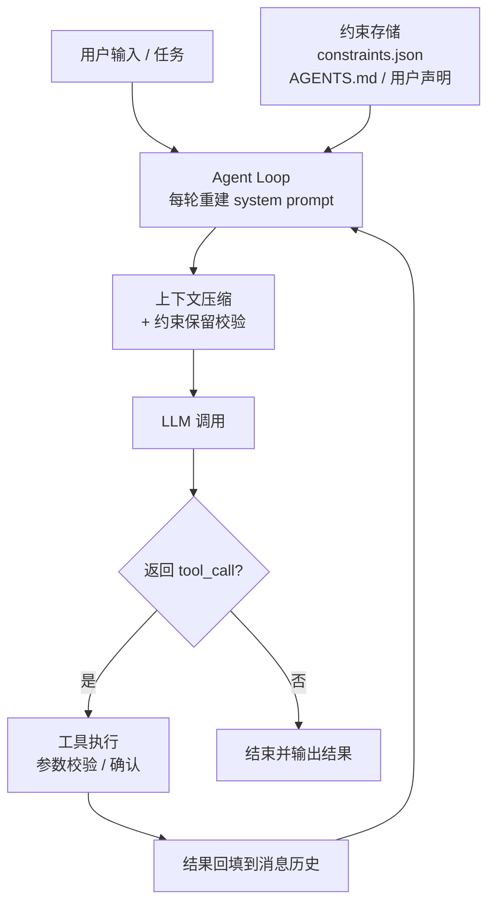

# Agent 约束遵守：违反归因、可复现评测与训练侧能力边界验证

> 基于从零实现的终端 Coding Agent，不依赖 LangChain 等 Agent 框架。核心问题不是“再做一个 Agent”，
> 而是：长任务里的关键约束为什么会丢、怎么把“为什么”变成可复现的 trace 与可证伪的归因。

**当前状态**：Agent Loop + 6 个内置工具 + 四层上下文压缩 + 关键约束保留 + 记忆/checkpoint/MCP
均已跑通。诊断侧的阶段 A 主样本 `stable=0`；方向 C 手工自检检查级 `0/40` vs 基线 `4/40`、
rollout 级 `0/20` vs `2/20`，Fisher `p>0.05`；受控冲突 4 组 × 5 次，强冲突 5/5 识别
`unresolved_conflict`，但 0/5 格式失败。统一数据集 pilot 与 final-test-v2 的 S0/S1 结果
见 `## 评测`：S0 110 条 0 error、19 个原始 stable / 15 个 valid stable（6 任务），S1
24/20、task_success 10/110，是负收益，按预注册门禁不工程化。

训练侧（`training/`，主线之一）在 Kaggle T4 完成 7B QLoRA 方法对照。train-v4 380/80
冻结，tokenizer 门禁后 361/74、90 optimizer step；6 个行为 held-out 任务 × 10 rollout：
baseline `40/60`、full-loss SFT `50/60`（BASE `30/30`、HARD `20/30`、CTX-HARD
`10/10 → 0/10`）、assistant-only SFT `60/60`（BASE/HARD `30/30`、CTX-HARD 恢复
`10/10`）、+15% Dolly 仍 `50/60` 且 CTX-HARD `0/10`、0 次工具调用。DPO 结果见
`docs/evidence/训练管线验证.md`。1.5B 是能力边界探针（89 条数据 SFT `20/60`，
HARD `10/30`，但 A-C1-HARD 出现 10/10 重复读循环）；7B v9 的 `60/60` 是模板修复后的
管线验证，不是方法增益。

根因侧：训练/推理 chat template 未传 `tools=` 时，同一轨迹训练渲染 307 token、推理
1567 token；修复后 BASE 从 `0/30` 恢复。loss masking 是另一个已定位变量：full-loss 的
CTX 退化在 assistant-only 下消失；+15% 通用数据没有复现收益。两 seed 的 task_success
完全一致，stable 2→3 波动 1 项；只有 6 任务、2 seed，不报置信区间。

constrained decoding 在 Kaggle 仍 0 rollout（v1 路径 ERROR、v2 依赖 ERROR、v3 取消、
v4 加载超时），S2 保持“预注册、0 rollout”。修正后的原 benchmark 只作为历史回归基线，
不进入训练集。项目定位是**违反归因 + 可复现评测 + 训练侧能力边界验证**，`training/`
不是工程储备，是主线之一。


## 为什么做

现有 Coding Agent 在长任务中会因上下文压缩丢失早期设定的关键约束（如「必须兼容 Python 3.9」「禁止修改数据库迁移文件」），导致后续步骤违反规则。本项目在对照 Claude Code 公开设计的基础上，重点解决**上下文压缩中的约束静默丢失**问题。

## 为什么主实验没有进入训练

这里说的是“主实验（四组对比 + 阶段 C）没有启动”，不是“`training/` 没动”。训练侧已在
独立目录完成 1.5B QLoRA 小规模验证，见本节末尾和 `docs/evidence/训练管线验证.md`。

主实验不启动不是免责声明，而是预注册门禁的执行结果：

- **主样本没有 stable 违反**：stress on run 2/10 各 10 次 rollout，固定
  `temperature=0.0`、`top_p=None`、`seed=20261019`；4 条违反检查全部是 `intermittent`
  （每个 run 的 `json_valid` / `snake_case_keys` 各 1/10），没有达到 `>=6/10` 的 stable 门槛。
- **负对照也没有 stable 违反**：C1/C2/C3 的 off 组共 16 条检查违反，全部 `intermittent`；
  3 次约束整段丢失已单独记录，没有混进步数超预算失败。
- **方向 A/B 没有证据**：trace 中工具参数合法、约束原文在当轮 messages 中，没有出现
  “schema 内嵌约束”或“约束被压缩掉”能解释的稳定失败。
- **方向 C 只有描述性信号**：手工自检把 `json_valid` / `snake_case_keys` 从基线 `4/40`
  降到 `0/40`，满足预注册门槛；但 Fisher 精确检验 `p=0.1156`（检查级）/
  `0.4872`（rollout 级，按真实的 `2/20` vs `0/20` 重算），样本量不足以证明收益。
  按门禁不工程化。
- **阶段 C 门禁未满足**：只有自检后仍有 3+ 次 stable 行为违反才进入阶段 C；本次没有。
- **统一数据集 pilot 还没有稳定信号**：7 dev + 7 test 的 pilot baseline 各 70 次 rollout，
  stable=0；最高非零项是 `tools_allowed` / `source_count_correct` / `json_valid`，全部低于
  6/10。该 test 是在若干 pilot 调整后冻结的，不能当成严格一次性 held-out。
- **`deepseek-flash` 的 dev-only 难度阶梯没有 stable 信号**：11 个任务 × 10 次 rollout，
  覆盖约束数量、上下文长度、工具参数、冲突、检查深度五维；hard 最高 4/10，五维 stable 全为 0。
  两轮相同配置的 560 个配对观测中翻转 20 个（3.57%），说明 temperature=0 仍不能把单轮差异
  当稳定能力。
- **1.5B 小基座首次触发 stable 门禁**：v7 + CTX 重跑合计 110 条有效 rollout，出现 20 个
  stable 违反检查项（全部 10/10），包括 `constraint_count` 10 项、`context_length` 2 项、
  `tool_parameters` 3 项、`conflict` 5 项；`check_depth` 为 0。stable 分布在 7 个任务上，
  不是单任务设计问题。`CTX-HARD` 只读 2/10 文件并答错，`TOOL-HARD` 返回 `total_lines=18`
  （期望 16），`CONFLICT-WEAK` 未按约束写小写文件名，`CONFLICT-STRONG` 未声明互斥冲突而
  直接写文件。明细见 `docs/evidence/小基座v7结果.md`。
- **final-test-v2 的 S0/S1 给出了负结果**：S0 110 条、0 error、19 个原始 stable、15 个 valid
  stable，task_success 40/110；S1 把 valid stable 推到 20、task_success 降到 10/110，并把
  `U-FT03/10/11` 从 10/10 成功推到 0/10。方向 C 的 prompt 自检没有收益，按门禁不工程化。
- **主实验训练分支没有启动**：`train-v1`（22 任务）与四组 runner 已就绪，但 S1 未通过收益
  门禁，四组对比（baseline / +系统侧 / +训练 / +组合）不执行。训练侧只在独立 `training/`
  做了 1.5B QLoRA 小规模验证，不等同于四组对比；S2 constrained decoding 仍是 0 rollout，
  不能因为 S0 出现 stable 就自动开训。
- **训练侧方法对照（train-v4，独立于主实验）**：7B QLoRA 在同一 6 任务 held-out 上，
  baseline `40/60`、full-loss `50/60`、assistant-only `60/60`、+15% Dolly `50/60`；
  full-loss 的 CTX-HARD 从 10/10 退化到 0/10，assistant-only 恢复 10/10，+15% Dolly
  仍 0/10 且 0 次工具调用。DPO 结果见 `docs/evidence/训练管线验证.md`。这组数字回答
  “训练侧哪个变量有效”，不替代主实验的四组对比，也不把 6 任务结果写成普遍增益。

因此项目最终定位是**约束违反诊断 + 可复现评测方法论 + 训练侧能力边界验证**；`training/`
是主线之一，不是工程储备。负结果、完整 trace、归因 CSV、翻转率、受控冲突实验、
final-test-v2 的 S0/S1 对比，以及 1.5B SFT 的真实 held-out 结果都是交付物。
主实验门禁仍未满足，不能把“1.5B 单任务行为变化”写成“训练普遍有效”。
执行说明见 `training/kaggle/README_kaggle.md`，详细结果见 `docs/evidence/训练管线验证.md`。

### 训练侧方法对照（train-v4，7B QLoRA）

数据：train-v4 380/80 冻结；Qwen tokenizer 门禁后 361/74，90 optimizer step。
行为 held-out：6 个任务 × 10 rollout，`temperature=0.0`、`top_p=None`、`seed=20261019`。

| 条件 | 总体 | BASE | HARD | 工具结果 | raw stable |
| --- | ---: | ---: | ---: | ---: | ---: |
| baseline（7B 基座） | 40/60 | 20/30 | 20/30 | 160/180 | 4 |
| full-loss SFT | 50/60 | 30/30 | 20/30 | 120/120 | 2 |
| assistant-only SFT | 60/60 | 30/30 | 30/30 | 170/170 | 0 |
| +15% Dolly | 50/60 | 30/30 | 20/30 | 70/70* | 3 |
| SFT + DPO | 见 `训练管线验证.md` | | | | |

\* mix15 在 CTX-HARD 上 0 次工具调用；70/70 只是“已发生调用”的成功率，不是覆盖率。

读法：

- full-loss 的净收益是 BASE +10、HARD 净 0；`A-C1-HARD` 和 `CONFLICT-WEAK` 被修复，
  `CTX-HARD` 从 10/10 退化到 0/10。
- assistant-only 把 `CTX-HARD` 恢复到 10/10，总体 60/60；单 seed、6 任务、已饱和，
  不能写“普遍有效”。
- +15% Dolly 没有缓解 CTX 退化，反而变成 0 次工具调用；这是负结果。
- 2 seed 的 task_success 完全一致，stable 2→3 波动 1 项；不报置信区间。

1.5B 能力边界探针（历史）：89 train / 30 val、22 step，baseline `10/60` → SFT `20/60`，
BASE `10/30 → 10/30`，HARD `0/30 → 10/30`；但 HARD 提升只来自 `TOOL-HARD` 的算术
修正，`A-C1-HARD` 出现 10/10 重复读循环，新增 10 条步数失败。结论是“管线跑通 +
单任务行为变化”，不是训练普遍有效。

7B v9 模板验证（历史）：89 train、22 step，baseline `40/60` → SFT `60/60`；v5 的
BASE 全灭（`20/30 → 0/30`）根因是训练未传 `tools=`，训练渲染 307 token vs 推理
1567 token；v9 修复后 BASE/HARD 均 `30/30`。它是模板一致性验证，不是 train-v4 方法对照。


## 核心特性

**已实现：**

- ✅ **项目脚手架**：src-layout 打包，`lite-agent` 入口可用
- ✅ **CLI 骨架**：基于 argparse 的命令行入口与参数解析，`lite-agent chat "任务"` 可执行
- ✅ **Agent Loop**：`while(true)` 主循环，模型返回 tool_call 后就执行并回填结果，`max_turns` 默认 10
- ✅ **LLM Provider**：OpenAI 兼容协议抽象，从环境变量读取 API Key / Base URL / Model
- ✅ **工具系统**：6 个工具全部可用 —— `read_file` / `write_file` / `list_dir` / `edit_file` / `bash` / `grep`（Pydantic 参数校验 + 路径越界拦截）
- ✅ **edit_file 三道防线**：read-before-edit、mtime 防护、`old_string` 唯一性校验（重复时给出行号）
- ✅ **bash 安全与超时**：默认 30s 超时并终止整棵进程树、危险命令需显式确认、输出超 2000 行截断
- ✅ **流式输出**：模型文本逐字写 stdout，工具调用与结果实时写 stderr
- ✅ **四层上下文压缩**：Tier 1 预算截断（头尾保留）/ Tier 2 裁剪重复 / Tier 3 空闲微压缩 / Tier 4 全量摘要；触发线 60% 与 85%，Tier 4 压完仍高于触发线时保留窗口按 (10, 5, 3, 1) 阶梯收窄，每层都记录前后 token 数与耗时
- ✅ **关键约束保留（核心差异化机制）**：约束独立存于 `constraints.json`，两条并行注入通道——每轮把清单追加进 system prompt（短任务不压缩也生效），压缩时摘要 Prompt 再逐条保留一次；压缩后按 id 校验并补录漏掉的原文。压力档两批各 10 次、合并 20 次实测：开启「上下文里仍在」800/800、关闭 640/800；逐字保留 95.0% vs 69.0%
- ✅ **项目记忆**：按目录层级向上加载 `AGENTS.md`，C1–C5 解析为 `source=agents_md` 的约束，改文件后下一轮刷新
- ✅ **会话持久化**：`session.jsonl` 逐轮追加，kill 后新进程能恢复消息历史 / token 计数 / 约束状态
- ✅ **MCP 客户端（stdio）**：手写 JSON-RPC over stdio，`initialize` / `tools/list` / `tools/call` 全流程；发现的工具按 `mcp__<server>__<tool>` 注册进工具表。MCP 调用前额外过一道约束校验（本项目原创设计，见 ADR-018）

## 架构图



> 上图只画主链路；完整的模块依赖图（`core` / `tools` / `memory` / `cli` 之间关系）与模块职责表见 `docs/architecture.md`。

## 快速开始

### 环境要求

- Python 3.11+
- 一个支持工具调用的 LLM API（如 Claude、GPT-4o、DeepSeek）

### 安装

```bash
git clone https://github.com/autumnieave/lite-coding-agent.git
# 网络受限时可用 SSH：git clone git@github.com:autumnieave/lite-coding-agent.git
cd lite-coding-agent
python -m venv .venv
source .venv/bin/activate   # Windows PowerShell: .\.venv\Scripts\Activate.ps1
pip install -e ".[dev]"
```

### 配置

参考仓库根目录的 `.env.example`，设置三个环境变量：

```bash
export LLM_API_KEY="your-api-key"
export LLM_BASE_URL="https://api.deepseek.com/v1"   # OpenAI 兼容端点，按需修改
export LLM_MODEL="deepseek-chat"
```

> 配置优先级：**已存在的环境变量 > `.env` 文件**。CLI 会从当前目录起向上最多 5 层查找 `.env`，
> 三种写法都支持：`KEY=VALUE`、`export KEY=VALUE`、`$env:KEY=VALUE`（PowerShell 习惯）。

### 运行

```bash
lite-agent --help                            # 查看用法与参数
lite-agent chat "列出当前目录"                # 执行一次任务
lite-agent chat "列出当前目录" --verbose      # 同上，打印每次工具调用的完整参数与结果
lite-agent chat "用 echo 工具说 hello" --mcp-server "python examples/echo_mcp_server.py"   # 接一个 MCP server
```

> 输出分流：**stdout 只放模型的最终答案**，工具进度默认就实时上报到 **stderr**（`· ` 前缀；`--verbose` 换成 `[verbose] ` 并带完整参数与结果）。因此 `lite-agent chat "..." > answer.txt` 拿到的始终是干净答案。
> 退出码：0 成功 / 1 任务失败（含达到轮数上限）/ 2 配置或用参错误。

## 项目结构

```
lite-coding-agent/
├── src/agent/
│   ├── core/          # Agent Loop、LLM 抽象、上下文管理
│   ├── tools/         # 工具注册表与具体工具
│   ├── memory/        # 项目记忆与会话持久化
│   ├── mcp/           # MCP 客户端（stdio + JSON-RPC）
│   └── cli/           # 命令行入口
├── tests/             # 单元测试
├── docs/              # 架构与决策文档
├── AGENTS.md          # 项目规则（Agent 启动时加载）
├── pyproject.toml
├── LICENSE
└── README.md
```

## 核心设计

### Agent Loop

主循环只有一条规则：**模型返回 tool_call 就执行，否则结束**。工具执行失败时，错误信息回填给模型，由模型自行修正。

### 上下文压缩与约束保留（核心差异化机制）

| 层级     | 策略   | 触发条件               |
| -------- | ------ | ---------------------- |
| Tier 1   | 预算截断 | 工具输出超过阈值       |
| Tier 2   | 裁剪重复 | 同文件重复读取、旧搜索结果 |
| Tier 3   | 微压缩   | 空闲后缓存失效         |
| Tier 4   | 全量摘要 | 上下文接近窗口上限     |

**关键约束保留机制**：

- 约束来源：用户显式声明、`AGENTS.md`、Agent 自行识别。
- 存储：独立 `constraints.json`，不参与压缩。
- 注入（两条并行通道）：每轮把清单追加进 system prompt，短任务不压缩也能看到；压缩时摘要 Prompt 再逐条保留一次。
- 校验：压缩后检查约束 ID 是否完整，丢失则按原文补录回上下文。
- 验证：压力档对比实验（两批各 10 次，合并每组 20 次），关闭机制违反约束 19 次 / 开启机制 5 次；「上下文里仍在」开启组 800/800、关闭组 640/800。详见 `docs/evidence.md` 用例五。

### 设计取舍

- **为什么不用 LangChain**：`AgentExecutor` 是黑盒，循环何时继续、工具错误怎么回填、上下文什么时候被裁都不可见也不可控；自研可以把这三件事完全握在手里。
- **为什么压缩阈值选 60%**：预留缓冲，避免压缩后立即再次触发；60% 是经验值，后续会用实验校准。
- **为什么记忆不用向量数据库**：项目规则是结构化文本，Markdown + 目录层级加载足够，引入向量库增加复杂度和不确定性。

## 路线图

- [x] 项目脚手架与 CLI 入口
- [x] Agent Loop + LLM Provider + 3 个基础工具（`lite-agent chat "任务"` 单次执行）
- [x] 6 个核心工具 + 流式输出
- [x] 四层上下文压缩
- [x] 关键约束保留机制 + 对比实验
- [x] 约束注入 system prompt（短任务不触发压缩也生效）
- [x] 项目记忆 + checkpoint
- [x] 单元测试 + GitHub Actions
- [x] MCP 客户端（stdio + JSON-RPC，含执行层约束校验）
- [x] 阶段 A：逐轮 trace（messages / 工具参数 / 约束位置 / 压缩事件）+ 固定采样配置
- [x] 违反根因分布表 + 检查项命中率表 + 翻转率报告 + 冲突专项
- [x] 方向 C 手工自检扩采样（20 次）+ 预注册门槛 + Fisher 检验
- [x] 统一数据集 pilot（7 dev + 7 test × 10 rollout，两 split stable=0）
- [x] 统一数据集最终 test 冻结（`final-test-v2`，11 任务，SHA-256 `d8290751...458e`；v1 已作废保留）
- [x] `final-test-v2` S0 baseline（110 条、0 error、19 原始 stable / 15 valid stable、6 个任务）
- [x] `final-test-v2` S1 prompt 自检（110 条、0 error、24 原始 stable / 20 valid stable、task_success 10/110；负结果）
- [x] `train-v1`（22 任务）与四组 runner 预注册
- [x] Kaggle T4：1.5B QLoRA SFT 真实运行（train 89 / val 30、22 optimizer step、adapter 校验通过）
- [x] 1.5B SFT held-out 对比（6 任务 × 10 rollout × 2 组；BASE/HARD 分拆）
- [ ] 四组对比（baseline / 系统侧 / 训练 / 组合；S1 未通过收益门禁，未启动）
- [x] Kaggle T4：Qwen2.5-7B 模板修复锚点（89 条 train-v2；baseline 40/60 → SFT 60/60；BASE/HARD 均 30/30，valid stable 4→0）
- [x] train-v4 数据冻结（380 train / 80 val；tokenizer 门禁后 361/74，90 optimizer step）
- [x] train-v4 7B QLoRA 基线 + seed2（baseline 40/60；full-loss SFT 50/60，BASE 30/30、HARD 20/30）
- [x] Loss masking 对照（full 50/60 → assistant-only 60/60；CTX-HARD 0/10 → 10/10）
- [x] 数据配比对照（+15% Dolly 仍 50/60；CTX-HARD 0/10 且 0 次工具调用）
- [ ] DPO 对照（v1 T4 OOM；v2 预计算 reference log probs，结果待落盘）
- [ ] lr/rank 与 DRIFT-Bench（未跑；不写结果）
- [ ] GRPO（仅在 SFT 结果与 reward 能惩罚步数循环后再评估）
- [ ] Kaggle T4：Outlines constrained decoding baseline（v1 路径 ERROR、v2 bitsandbytes ERROR、v3 取消、v4 加载超时；0 条结果，无指标）

## 评测

**约束保留对比实验**（`scripts/constraint_experiment.py`，真实 `deepseek-flash`，判定全部脚本化）

压力档：40 条约束 / 25 轮会话。下表是修复后代码的 **两批复跑合并**（每组 20 次）：

| 组 | 约束原文逐字保留 | 上下文里仍在 | 压缩后补录 | 违反约束次数 | 任务成功 |
|---|---:|---:|---:|---:|---:|
| 关闭机制 | 552/800（69.0%） | 640/800 | — | 19 | 13/20 |
| **开启机制** | **760/800（95.0%）** | **800/800** | 120 | 5 | 18/20 |

关闭机制的 20 次里有 **4 次把 40 条约束整段丢掉**、另有 **2 次** 40 条还在上下文里但逐字形式全部失去；开启机制遇到同样情况时，压缩后校验按原文逐条补回（累计 120 条），所以「上下文里仍在」始终是 **800/800**。**机制买到的是「整段丢失也丢不掉」这条确定性，不是行为指标的提升**——3 项行为探针只覆盖 40 条约束中的 3 条，衡量不了约束本身。

同一批实验还量化了四层压缩的两处优化收益：Tier 4 触发次数从均值 11.0 / 13.1（最大 21 / 24）降到均值 4.6\~5.4（最大 6\~7）；摘要消息数从「等于压缩次数」降到恒为 1。

> 首轮实验对照组（372/400）在修复摘要叠加 bug 后重跑，回到 69%：那次数据里还残留一条隐式保留通道（旧摘要原文被反复复制进新摘要），拆掉后对照组回到 69% 左右。原因见 `docs/evidence.md` 用例五。
> 尚未纳入：Terminal-Bench 公开任务通过率。
> 复现命令与完整逐次记录见 `docs/evidence.md` 用例五 \~ 用例七与 `docs/evidence/*.jsonl`。

**Agent Benchmark（内部行为评测，非公开榜单）**（`scripts/benchmark.py`，12 个自写任务 × 3 次，真实 `deepseek-flash`，判定脚本化；用于本项目 on/off 对照，不做跨模型排名；下表为 `on` 档）

评的是**行为质量**（工具选择、参数准确、步数预算、错误恢复、约束遵守、长上下文召回），不是答案质量。

**正确性与效率分开看**（`task_success = 内容判定 ∧ 步数判定`）：

| 类别 | 次数 | 内容正确 | 步数达标 | 任务成功 | 平均步数 |
|---|---:|---:|---:|---:|---:|
| retrieval | 12 | 100.0% | 91.7% | 91.7% | 2.2 |
| edit_exec | 12 | 100.0% | 66.7% | 66.7% | 6.3 |
| long_context | 12 | 100.0% | — | 100.0% | 12.3 |

**内容判定 36/36 全为真**（文件找对、`edit_file` 改对、JSON 合法、总行数算对）；
没达标的 5 次全部只挂在步数预算上（A/B 类 24 次里 19 次达标）——B 类反复用
`bash` 试探 Windows shell 绕了路。逐任务稳定性表与两个已修的判定缺陷见 `docs/evidence.md` 用例九。

C 类另补了 `off` 档对照（关闭约束存储、压缩照常发生，每组 12 次）：**内容判定
`on` 12/12 vs `off` 6/12**，`off` 违反 9 次、其中 3 次是约束被压缩整段丢掉。两组 Tier 4 触发次数（36）
与摘要消息数（1）完全相同，差异只来自约束保护——机制买到的是「整段丢失也丢不掉」的确定性。

**阶段 A：违反归因（10 次 rollout / run）**

稳定性阈值预先固定：同一检查项 10 次中命中 `>=6` 为 `stable`，`1-5` 为 `intermittent`，
`0` 次不进入根因表。每条违反以当轮实际 messages、完整 response、工具参数与约束位置为准，
不以 `reply_head` 或 `constraints.json` 是否存在单独判断。

| 样本 | rollout | 违反检查项 | stable | intermittent |
| --- | ---: | ---: | ---: | ---: |
| 主样本 stress on run 2/10 | 20 | 4 | 0 | 4 |
| 负对照 C1/C2/C3 off | 90 | 16 | 0 | 16 |

方向 C 手工自检把 `json_valid` / `snake_case_keys` 从基线 `4/40` 降到 `0/40` 检查违反，
满足预注册门槛；但 Fisher 精确检验 `p=0.1156`（检查级）/ `0.4872`（rollout 级），
只能写“描述性有信号、样本量不足以证明收益”，不工程化。受控冲突实验（4 组 × 5 次）中，
强冲突 5/5 识别出 `unresolved_conflict`，但 0/5 产生稳定格式失败，因此不把冲突升级为
能力问题。完整证据见 `docs/evidence/阶段A_10rollout结论.md`、`docs/evidence/冲突专项.md`、
`docs/evidence/方向C手工验证.md` 与 `docs/evidence/违反根因分布表.csv`。

**final-test-v2 S0 / S1（Qwen2.5-1.5B-Instruct，10 次/任务）**

| 指标 | S0 | S1 |
| --- | ---: | ---: |
| rollout / error | 110 / 0 | 110 / 0 |
| 原始 stable 检查项 | 19 | 24 |
| valid stable（剔除 `within_steps=false`） | 15 | 20 |
| 触发 valid stable 的任务 | 6/11 | 9/11 |
| task_success | 40/110 = 36.4% | 10/110 = 9.1% |
| 轨迹完整 | 110/110 | 110/110 |

S0 的 10 次步数失败集中在 `U-FT01-BASE`（重复 `read_file` 6 轮），按预注册口径不进入
约束违反归因；S1 把该循环修掉，却在 `U-FT02-HARD` 引入同类 10/10 步数失败，并把
`U-FT03/10/11` 从 10/10 成功推到 0/10。S1 的 prompt 自检对“只输出一个值”的任务产生
格式漂移，属于负收益，不工程化。完整证据见 `docs/evidence/final_test_v2_baseline.md` 与
`docs/evidence/final_test_v2_S1.md`。

## 已知限制

完整清单、每条「为什么接受 / 后续怎么改」见 [`docs/evidence.md`](docs/evidence.md) 的「已知限制与后续迭代项」。摘要：

- **Tier 4 触发均值 4.6\~5.4**：压力档修复后均值 4.6\~5.4 / 最大 6\~7，仍在收敛区间。
- **API 主样本 stable=0，但 1.5B 小基座已触发门禁**：`deepseek-flash` 的 10 次/run
  下所有违反都是 `intermittent`；`Qwen2.5-1.5B-Instruct` v7 + CTX 重跑出现 20 个
  stable 违反检查项。`final-test-v2` 的 S0 有 15 个 valid stable（6 个任务），S1 反而
  升到 20 个（9 个任务），所以门禁只支持“继续诊断”，不支持“进入训练”。
- **训练侧是能力边界验证，不是普遍有效**：`Qwen2.5-1.5B-Instruct` 完成 1 次 QLoRA SFT
  （train 89 / val 30、22 optimizer step、adapter 311 MB 校验通过）。held-out 6 任务 ×
  10 rollout：task_success 16.7% → 33.3%，但 BASE 持平、HARD 提升只来自 `TOOL-HARD`；
  `A-C1-HARD` 新增 10/10 步数循环。7B v5 曾严重退化（40/60 → 20/60，BASE 20/30 → 0/30），
  但 v9 修复训练/推理模板并保留 3072 序列长度后恢复到 60/60（BASE/HARD 均 30/30，valid
  stable 4 → 0）；1.5B 循环未在 7B 复现。结论只支持“模板一致性是数据管线关键门禁”，
  不支持“训练普遍有效”；GRPO 暂缓。
  constrained decoding v1/v2 因路径/依赖 `ERROR`，v3 取消，v4 在权重加载阶段超时，0 条结果。
  工具结果按调用计 90/90 → 250/250 全成功，但调用总数从 90 涨到 250，不能把“每次调用合法”
  写成效率提升。
- **行为验证覆盖面窄**：40 条约束里只有 3 条有输出层判定（JSON / snake_case / 无代码围栏），其余只统计「还在不在上下文里」。
- **约束来源未全覆盖**：对比实验只走「用户声明」一条路径，`source=agents_md` 没有进过实验数据。
- **MCP 只支持 stdio**：没有 SSE / OAuth / 动态工具刷新 / 连接重试。
- **执行层约束校验只看工具名、不看参数**：拦不住「用 echo 工具把 Key 回显出来」这类（ADR-018）。
- **退出时的上游 traceback**：`httpcore2` 关闭流的缺陷，不影响退出码、stdout 与文件改动（ADR-007）。
- **MCP 端到端用例在高负载下偶发失败**：`tests/test_mcp_cli.py` 会真的拉起子进程，已标 `slow`、CI 单独 job 跑；本地 `pytest -q -m "not slow"` 当前 732 passed + 1 skipped。

## Related Work：为什么选 constrained decoding

- **选它，是因为可比**：本阶段主样本是 `json_valid` / `snake_case_keys` 这类输出格式
  违反，能被脚本确定性判定；Outlines / JSON Schema constrained decoding 是同一层面的
  外部系统侧方案，适合做“训练是否必要”的对照。如果它把违反压到 0，就说明主样本不需要
  用 SFT 解决，而不是“训练没用”。
- **暂不接 Guardrails**：Guardrails 更偏运行时校验/安全策略编排，接入会引入新的框架
  抽象与失败模式，反而混淆“输出格式”这一单一变量；当前样本不需要它。
- **暂不接 τ-bench**：τ-bench 评的是工具-用户交互与任务完成，不是输出格式约束；接入
  会扩大阶段 A 的范围，也无法直接复用现有 trace 判定。
- **当前状态**：`training/kaggle/kaggle_constrained_decoding.py` 与 notebook 已就绪，
  本地只测 schema/校验逻辑；Kaggle v1 因 7B 路径不存在 `ERROR`，v2 因缺少 `bitsandbytes`
  `ERROR`，v3 取消，v4 在 1.5B 权重加载阶段 900 秒超时、0 条结果。没有可用指标，结果出来前
  不写命中率结论；S2 因此保持 0 rollout，四组对比也未启动。

## 参考

- [claude-code-from-scratch](https://github.com/Windy3f3f3f3f/claude-code-from-scratch) —— 分步教程（双语言实现，逐章带 Claude Code 架构对照），用作 Agent Loop、工具系统、流式输出、上下文压缩、会话存储的对照来源
- [How Claude Code Works](https://github.com/Windy3f3f3f3f/how-claude-code-works) —— 源码级解析，用于理解 Agent Loop 与上下文压缩
- [Outlines](https://github.com/dottxt-ai/outlines) —— JSON Schema / regex constrained generation，用作输出格式违反的外部系统侧 baseline
- [JSON Schema](https://json-schema.org/) —— constrained decoding baseline 的 schema 约束来源

**哪些模块有对照、哪些是自研**（完整表见 `docs/decisions.md` 开头）：

| 模块 | Claude Code 对照 | ADR |
|---|---|---|
| Agent Loop / 工具系统 / 流式输出 / 上下文压缩 / 会话 checkpoint | **有**——对照的是设计取舍，代码全部自写，差异逐条记在 ADR 里 | ADR-006 \~ ADR-011、ADR-013、ADR-015 |
| 项目记忆读 `AGENTS.md` | **部分**——Claude Code 里对应的是 CLAUDE.md 机制，**不是**它那套跨会话 memory 系统（四分类 + 语义召回） | ADR-014 |
| MCP 客户端 | **有**——SDK 封装 / stdio + SSE / 三段式命名 / 15s 超时 | ADR-017 |
| **关键约束保留** | **无，本项目原创**——Claude Code 与参考项目都没有「约束独立存储 + 压缩前注入 + 压缩后校验自愈」 | ADR-004、ADR-012、ADR-016 |
| **MCP 工具的执行层约束校验** | **无，本项目原创**——拦截依据是本项目自己的约束清单 | ADR-018 |

> 所以本项目**不是**「参考 Claude Code 做的复刻」：核心差异化机制（约束保留）是原创，其余模块是照着公开设计重写并记下差异。

## License

MIT，见 [LICENSE](LICENSE)。
