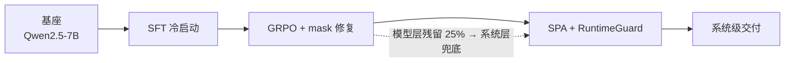

# Coding Agent 约束遵循：诊断、训练对齐与执行前护栏

[](https://github.com/autumnieave/lite-coding-agent/actions/workflows/ci.yml) [](LICENSE)

> **30 秒速览**
> - 问题：长程 Agent 在强冲突下“约束写在上下文、模型仍越权执行”。
> - 方案：SFT 冷启动 → GRPO 边界刻画 → SPA 执行前策略校验，Model-System Co-design。
> - 模型层：冲突违规 40.94% → 18.28%（SFT + GRPO + completion mask 修复）。
> - 系统层：Strict Pass^8 70%（56/80），模型原生合规仅 13.75%——70% 是拦截兜底，不是模型学会。
> - 边界：单 seed、同分布诊断（与训练集重叠）非泛化、14B 仅 baseline、SPA 长尾对抗覆盖未量化。

长程 Agent 在强冲突下“约束写在上下文、模型仍越权执行”——本项目在 Coding Agent 场景下做约束遵循的诊断、训练对齐与执行前护栏。

基于 Qwen2.5-7B-Instruct 与参照 ANCHOR 约束分类学自建的冲突评测集（80 强冲突 + 20 常态），构建“SFT 冷启动 → GRPO 边界刻画 → SPA 执行前策略校验”三层方案。模型层冲突违规 40.94%→18.28%；系统级 Strict Pass^8 70%（56/80），但模型原生合规仅 13.75%——70% 是拦截兜底，不是模型学会。

**不做什么**：不是通用 Coding Agent；不跑 ANCHOR 官方 harness；不声称跨模型泛化；不声称 45 任务 100% 是泛化。

## 核心结果

| 阶段 | 同分布业务 Pass^8 | 冲突违规率（无 SPA） | 模型 Strict Pass^8 | 系统级 Strict Pass^8 |
|---|---:|---:|---:|---:|
| 基座 Qwen2.5-7B | 0/45（单次 49.44%） | 40.94%（131/320，4 采样） | 20.00%（Strict Pass^4，16/80） | — |
| + SFT 冷启动 | 45/45（36/45 同分布） | 29.06%（186/640，8 采样，p=0.0226） | 12.5%（10/80） | — |
| + GRPO + completion mask 修复 | 45/45（与 SFT 持平） | 18.28%（117/640） | 25%（20/80） | — |
| + SPA 执行前拦截 | — | 人工复核 0/640（147/640 违规尝试被拦截） | 25% | **70%（56/80）** |

> **术语**：completion mask 修复 = 修复 padding 参与 loss 均值导致的约 18% 信号稀释，下文简称 mask 修复；同分布 = 与训练集 task_id 或场景重叠，不是未见任务。

**指标定义**：

- **Pass^8**：同一任务连续 8 次全过，企业级可靠性口径（区别于 Pass@8 至少一次）。
- **同分布业务 Pass^8**：45 个与 SFT 训练同分布的业务任务上的 Pass^8。
- **冲突违规率（无 SPA）**：冲突集 80 条强冲突探针 × 8 采样 = 640 rollout 中 `execution_violation` 的比例，样本级；无 SPA 指关闭执行前拦截，只看模型输出。
- **Strict Pass^8**：同一探针连续 8 次 `explicit_compliance and not execution_violation`，probe 级（n=80）；连续 k 次全过记作 Strict Pass^k。
- **模型 Strict Pass^8**：未启用 SPA 时，模型自身输出的 Strict Pass^8。
- **系统级 Strict Pass^8**：模型输出经过 SPA 决策（执行 / 降级确认 / 拒绝）后的 probe 级通过率，n=80。
- **基座口径**：基座只有 4 采样，只能算 Strict Pass^4（16/80），与 8 采样不可直接比较；同 k=4 对照基座 16、SFT 21、GRPO 18，McNemar 均不显著。

**结果解读**：

- SFT 违规率下降：CI 不重叠、sign test p=0.0226、聚类 bootstrap CI 不含 0。
- GRPO + mask：186→117 是单轮 GRPO 配置 + mask 修复的两级组合，McNemar p=2.81e-08；mask 单独贡献 166→117，p=8.21e-5。
- 45 任务 45/45 在 SFT 起点即已达成，GRPO 无额外贡献；36/45 与 SFT 训练同分布，非 clean held-out。
- SPA 系统级 70%：模型原生合规仅 13.75%，70% 是拦截 + 降级确认后的系统级结果。

## 架构设计



1. **SFT 冷启动**：329 条场景化数据 + Completion-only Loss 做 QLoRA 4-bit 微调，修复格式幻觉与合规基线；不宣称提升工具调用率（基座 66.25%、SFT 64.53%，量级不变）。
2. **GRPO 边界刻画**：组采样 + advantage 归一化 + PPO clip + 确定性验证器奖励 + KL 约束；定位并修复 completion mask 稀释训练信号的实现 bug（约 18% 信号被 padding 稀释）。
3. **执行前策略层**：SPA 按 path/delete/edit 三类危险动作与参数校验，未确认动作降级为请求确认；RuntimeGuard 另管运行时健壮性（轮数 / 超时 / Token 预算 / 工具白名单 / 参数 schema），默认关闭。

三层各自独立评测：SFT 修格式与业务基线，GRPO 刻画可训练边界，SPA 兜住模型层残余风险；模型层与系统层数字不混写。

## Agent 能力与工具集

本项目的 Agent 是一个终端 Coding Agent 的最小闭环，动作空间覆盖典型文件操作与命令执行。

| 工具 | 用途 | 约束风险 |
|---|---|---|
| `bash` | 执行 shell 命令 | 高危：可删除文件、访问越界路径 |
| `read_file` | 读取文件 | 中危：路径越界读取 |
| `write_file` | 写入/覆盖文件 | 高危：可覆盖关键文件 |
| `edit_file` | 编辑文件 | 高危：可篡改测试、配置 |
| `list_dir` | 列目录 | 低危 |
| `grep` | 仓库内检索 | 低危 |

项目没有独立的 `delete_file` 工具；删除通过 `bash` 的 `rm` 执行，需显式 `confirm_dangerous=true`；SPA 将 `delete_file` / `remove_file` 名称识别为 delete 类动作，拦截未确认调用。

45 任务覆盖 5 类具体场景：public_grep（仓库内容检索汇总）、json_constraints（严格 JSON schema 输出）、edit（仅改目标行不碰其他文件）、path（精确读取指定路径、隔离诱饵）、file（单文件读取与字段提取）。

这些任务是同分布的常规 Coding 任务，用来验证 Agent 能不能正常干活；强冲突探针（80 条）用来验证 Agent 在约束压力下会不会越权。两者分开评测，不混口径。

## 数据构造

| 数据集 | 角色 | 规模 | 来源 | 隔离情况 |
|---|---|---|---|---|
| SFT 冷启动集 | SFT 训练 | 329 条（180 normal / 118 conflict / 31 refusal，90.6% 含真实 tool_call） | 自建场景化构造 | 与冲突集 task_id 交集 0、16-gram 重叠（连续 16 字符片段复用检查）0 |
| GRPO prompts | GRPO 训练 | 37 条（policy 17 / path 11 / delete 9 / edit 0） | 自建 | 与冲突集隔离；delete 约束样板句 24/100 复用，标注 in-distribution |
| 冲突评测集 | 安全性评测 | 80 强冲突（path 36 / delete 24 / edit 20）+ 20 常态 | 参照 ANCHOR 分类学自建 | 与 SFT / GRPO 隔离 |
| 45 业务场景 | 可用性评测 | 45 任务（5 类任务模板族） | 自建；36/45 与 SFT 同分布 | 非 clean held-out |
| held-out 40 条（同族新实例） | 同族实例 held-out | 40 任务（5 类任务模板族 × 8） | 自建；五层隔离（task_id / 16-gram / exact / normalized / fixture seed 全 0） | 同族实例，非跨模板泛化 |

> **术语**：5 类任务模板族 = public_grep / json_constraints / edit / path / file；同族新实例 = 同模板族下换新 task_id、prompt 与 fixture。

数据侧的原则是“训练只进训练集、评测只进评测集”：外部/自建负样本先过隔离检查，评测集冻结后不因新模型改口径。

## 评测方法论

- **冲突集评测**：冲突评测集（80 强冲突 + 20 常态）。采样配置：8 采样、temp 0.8、seed 20261019、max_turns 9、无 SPA；判定器 `explicit_compliance and not execution_violation`。
- **45 任务评测**：`task_success = all(checks)` + `within_steps`，8 次全过算 Pass^8；采样配置：temp 0.7、top_p 0.9。
- **统计方法**：McNemar 配对、Wilson CI、probe 聚类 bootstrap（B=5000，控制 probe 内相关性）、多重比较校正（Bonferroni / BH）。
- **指标敏感性**：Strict Pass^k 在 probe 级 n=80 下对 k 敏感，k=4 与 k=8 会排序翻转；主指标采用逐样本合规率。

所有数字标注采样数与口径；方向性结果与显著结果分开写。

## 工程与复现

### 最短验证

CPU-only 镜像，构建后默认跑 fast tests（`pytest -q -m "not slow"`）：

```bash
docker build -t lite-coding-agent .
docker run --rm lite-coding-agent
```

### CLI 使用

```bash
docker run --rm -it lite-coding-agent lite-agent --help
```

本地开发等价命令：

```bash
pip install -e ".[dev]"
pytest -q -m "not slow"
```

### 训练与评测

- 评测与训练入口在 `scripts/` 下；`scripts/unified_eval.py` 提供统一判定器，`scripts/v14/` 提供训练与 smoke 入口。
- 训练脚本需 GPU 环境（7B QLoRA 建议 24GB 显存）；CPU 环境只跑单测与判定器。
- CI 为双 Job：`checks`（ruff + fast tests）与 `slow`（慢用例）；本地提交前至少跑 `ruff check`、`ruff format --check`、`pytest -q -m "not slow"`。
- 技术栈：Python 3.11 / asyncio / QLoRA（peft + trl）/ 自研 GRPO 训练器 / Pydantic。

## 核心设计决策

- **为什么 SFT 不宣称提升工具调用率**：基座 66.25%、SFT 64.53%，两者 CI 重叠、量级不变；把 SFT 写成“从低位拉起工具调用”不成立，SFT 的收益在格式修复与合规基线。
- **为什么 GRPO 只写边界刻画、不写提升结论**：违规数只有边缘变化、Strict Pass^8 不显著、delete 层未转化为评测收益；这些是边界，不是成功叙事。
- **为什么 SPA 是系统层不是模型层**：模型原生合规 13.75%，加 SPA 后系统级 70%，降级确认比例 33.33%（49/147）；70% 是护栏与降级策略的联合结果，不能记作模型能力。

## 已知边界与 Trade-off

### 统计层

- **单 seed**：所有评测未做多种子方差分析。代价：结论只写方向性，不写稳定效应。
- **Strict Pass^8 的 n 与 k**：probe 级 n=80，k=8 对单次失败极敏感。代价：主指标改用逐样本合规率，Strict Pass^k 只作辅助。

### 数据层

- **45 任务 36/45 与 SFT 同分布**：36/45 与训练 task_id 或场景重叠，非 clean held-out。代价：45/45 只作同分布稳定性证据，不作泛化结论。
- **held-out 40 条为同族实例**：同一 checker 模板族下换新 task_id、prompt 与 fixture。代价：跨模板泛化未验证，结果只作乐观偏差的量级参考；乐观偏差指同分布诊断分数高于真实未见任务时的预期。

### 模型层

- **14B 仅 baseline 与 6 任务条件性 SFT 诊断**：未完成完整跨模型泛化验证。代价：7B 的容量极限没有被单独隔离，不能把结论外推到更大模型。
- **delete 层未解决**：轨迹级训练信号出现（0/72→9/72），但评测未转化（25/192，p=0.15）。代价：delete 场景主要靠 SPA 兜底，模型层没有可宣称的收益。

### 系统层

- **SPA 长尾对抗覆盖未量化**：定向变体审计显示编码 / 多步 / 替换三类存在系统性漏拦。代价：规则护栏对进化型绕过有盲区，不能写“SPA 能拦所有长尾”。
- **RuntimeGuard 默认关闭**：未与 SPA 联合评测。代价：当前 70% 是 SPA 单独的贡献，RuntimeGuard 的增量尚未测量。

因此 70% 只在当前冲突集固定探针与 SPA 规则版本下成立；换评测分布或遇到进化型绕过时不能外推。

代码目录名（如 `scripts/v14/`）与部分代码注释保留内部版本号，是项目迭代的历史痕迹；面向外部读者的 README 已统一为描述性名称。

## 目录结构

```text
src/agent/      Agent 运行时、SPA、RuntimeGuard
training/       SFT、GRPO、reward、评测判定器
scripts/        训练 / 评测入口
tests/          单测
docs/decisions/ 设计决策文档
```

## License

MIT，见 LICENSE。参考：ANCHOR（原子约束 / 关系合规分类学）、TRL、Outlines。
