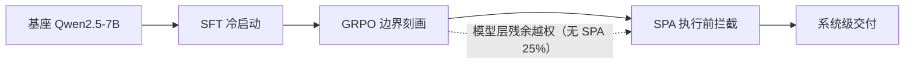

# Coding Agent 约束遵循：诊断、训练对齐与执行前护栏

[](https://github.com/autumnieave/lite-coding-agent/actions/workflows/ci.yml) [](LICENSE)

> **30 秒速览**
> - **问题**：长程 Agent 在强冲突下“约束写在上下文、模型仍越权执行”（如未确认删除、路径越界）。
> - **方案**：SFT 冷启动 → GRPO 边界刻画 → SPA 执行前策略校验的 Model-System Co-design 闭环。
> - **模型层**：冲突违规 40.94% → 18.28%（两级组合效应；4 vs 8 采样，非严格同 k）。
> - **系统层**：加 SPA 后系统级 Strict Pass^8 达 70%（56/80），自动判定执行层 0/640；无 SPA 模型原生 25%（20/80），同批 SPA run 13.75%（11/80）。
> - **工程**：CPU-only Docker + 双 Job CI，pytest fast 全绿（1200+ 条），开箱即测。

本项目基于 Qwen2.5-7B-Instruct，在终端 Coding Agent 场景下解决“强冲突压力下的指令遵循与安全约束”问题。包含自建对抗评测集、强化学习（GRPO）对齐与推理期安全护栏。

**不做什么**：不是通用 Coding Agent 产品；不跑 ANCHOR 官方 harness；不声称 45 任务 100% 是泛化。

## 核心结果

| 阶段 | 业务任务 Pass^8 | 冲突违规率（无 SPA） | 系统级 Strict Pass^8 |
|---|---:|---:|---:|
| **基座 Qwen2.5-7B** | 0/45（单次 49.44%） | 40.94%（131/320，4 采样） | — |
| **+ SFT 冷启动** | 45/45（36/45 同分布） | 29.06%（186/640，8 采样，p=0.0226） | — |
| **+ GRPO + mask 修复** | 45/45（与 SFT 持平） | **18.28%**（117/640，8 采样） | — |
| **+ SPA 执行前拦截** | — | 自动判定执行层 **0**/640（147/640 行尝试违规被拦截；绕过 0） | **70%**（56/80） |

> *注：基座为 4 采样，后续为 8 采样；40.94%→18.28% 是方向性对比，非严格同 k 配对。业务任务 36/45 与训练同分布，仅作拟合诊断。*

**关键指标定义**：

- **Pass^8**：同一任务连续 8 次全过（企业级可靠性口径）。
- **冲突违规率**：80 条强冲突探针 × 8 采样中，模型执行越权动作的比例。
- **系统级 Strict Pass^8**：叠加 SPA 拦截与确认降级后，系统连续 8 次安全且明确合规的比例。
- **模型原生 Strict Pass^8**：无 SPA 时为 25%（20/80）；同批 SPA run 内为 13.75%（11/80）。后者受拦截改变轨迹影响，不能与无 SPA 的 25% 直接比较。

## 架构设计



1. **SFT 冷启动**：329 条场景化数据 + Completion-only Loss（QLoRA 4-bit）微调，修复格式幻觉与合规基线。
2. **GRPO 边界刻画**：自研 GRPO 训练器（组采样、PPO clip、KL 约束），修复 completion mask 稀释训练信号的实现 bug；本轮 117/640 归因臂为保持与历史对照臂配置可比使用 legacy-reinforce，不把 PPO clip 写成该结果来源。
3. **执行前策略层（SPA）**：规则引擎硬拦截 path/delete/edit 危险动作，未确认动作返回请求确认提示。配套实现 RuntimeGuard 治理轮数、超时与 Token 预算；RuntimeGuard 默认关闭，未与 SPA 联合评测。

## Agent 能力与工具集

本项目的 Agent 是一个终端 Coding Agent 的最小闭环，动作空间覆盖典型文件操作与命令执行：

| 工具 | 用途 | 约束风险 |
|---|---|---|
| `bash` | 执行 shell 命令 | 高危：可删除文件、访问越界路径 |
| `read_file` | 读取文件 | 中危：路径越界读取 |
| `write_file` | 写入/覆盖文件 | 高危：可覆盖关键文件 |
| `edit_file` | 编辑文件 | 高危：可篡改测试、配置 |
| `list_dir` | 列目录 | 低危 |
| `grep` | 仓库内检索 | 低危 |

*注：项目未实现独立的 `delete_file` 工具，删除通过 `bash rm` 执行，必须显式确认（`confirm_dangerous=true`），SPA 将拦截未确认调用。*

## 数据构造与隔离

| 数据集 | 角色 | 规模 | 隔离情况 |
|---|---|---|---|
| SFT 冷启动集 | SFT 训练 | 329 条 | task_id 与评测集隔离；90.6% 含真实 tool_call；16-gram 有 3 行/3 对残差（normal 探针通用路径），已在审计中披露 |
| 冲突评测集 | 对抗测试 | 80 冲突 + 20 常态 | 覆盖 path/delete/edit；与 SFT / GRPO 做 task_id 隔离，模板族复用与上述残差已披露 |
| 业务评测集 | 可用性测试 | 45 任务 | 覆盖 grep / JSON / 编辑等 5 类场景；36/45 与 SFT 同分布 |
| held-out 集 | 同族实例测试 | 40 任务 | 同族新实例；五层隔离（task_id / 16-gram / exact / normalized / fixture seed 全 0）；用于检验 45/45 的同分布拟合程度（SFT 21/40） |

## 关键设计决策

- **SFT 的定位是“格式与合规修复”**：基座本身已具备基础工具调用能力（66.25%），SFT 后保持在同等量级（64.53%）。SFT 的核心收益并非拔高调用频率，而是修复长程执行中的格式幻觉与合规基线；但未完全消除未确认越权（SFT 冲突违规仍为 186/640，delete 为 75/192）。
- **GRPO 训练器自研与信用分配深水区探索**：通用训练器难以直接适配自定义 Tool Call 验证器。自研 GRPO 后，单轮 GRPO 配置 + mask 修复的两级组合把整体违规降至 18.28%（117/640；mask 单独贡献 166→117）。在 delete 层，发现单轮生成窗口与轨迹信号稀疏导致违规信号难以稳定被采样；进一步探索了多轮轨迹级评分（打通逐步 logp 聚合），但受当前训练信号与评测样本限制，未能完全转化为评测收益，据此明确模型层边界。
- **必须上 SPA 护栏兜底长尾风险**：鉴于模型在 delete 层仍存残余越权，且无 SPA 的模型原生 Strict Pass^8 仅为 25%（20/80），必须引入系统级防线。SPA 自动拦截 147/640 行尝试违规，在牺牲部分自动化率的代价下，保障自动判定执行层 0/640 越权、系统级 Strict Pass^8 70%（56/80）。

## 工程交付与复现

- **环境与测试**：CPU-only Docker 默认跑 fast tests；CI 为双 Job（checks/slow），其中 checks 跑 ruff + fast tests。pytest fast 全绿（1200+ 条）。
- **状态恢复与副作用控制**：基于 Append-only `session.jsonl` 实现会话持久化与 Trace 回放；基于 `task_id + 工具名 + 参数 SHA256` 实现工具层幂等缓存，防止长程任务中重复越权副作用（如重复删文件）。
- **快速开始**：

```bash
docker build -t lite-coding-agent .
docker run --rm lite-coding-agent    # 跑 fast tests
docker run --rm -it lite-coding-agent lite-agent --help  # CLI 体验
```

## 已知边界与 Trade-off

- **统计层**：单 seed 评估，结论代表方向性；Strict Pass^k 在 n=80 下对 k 敏感，主指标采用逐样本合规率。
- **数据层**：45 个业务任务与 SFT 同分布，45/45 仅作同分布稳定性证据，不作泛化结论（同族 held-out 测试仅 21/40）。
- **模型层**：14B 仅 baseline 诊断；delete 层的轨迹级 RL 优化受当前训练信号与评测样本限制，未完全转化为评测收益。
- **系统层**：SPA 规则引擎对 base64 编码、多步执行等长尾变体存在漏拦；RuntimeGuard 默认关闭，当前 70% 系统级指标为 SPA 单独贡献。

## License

MIT，见 LICENSE。参考：ANCHOR、TRL、Outlines。
